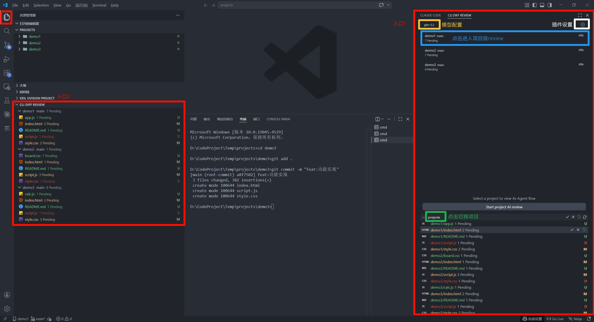
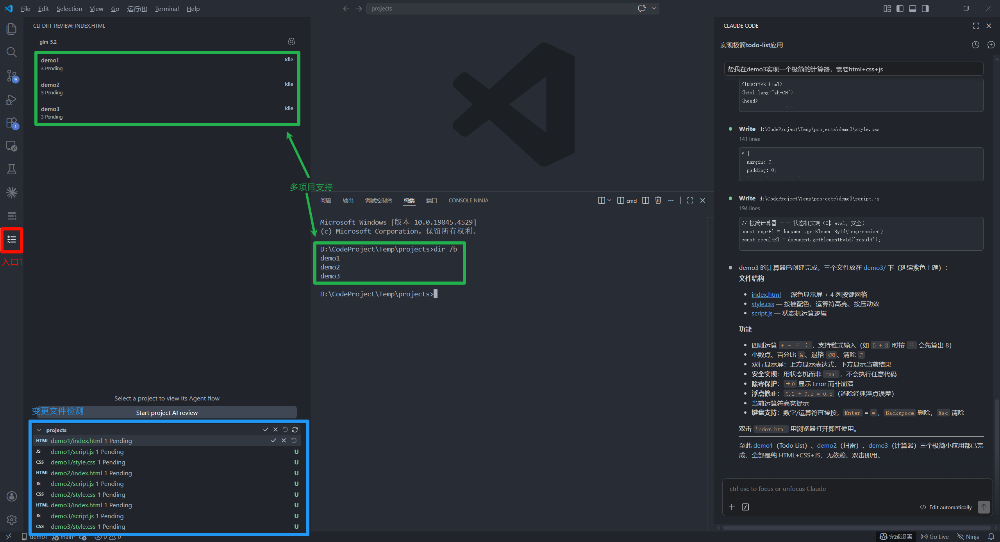
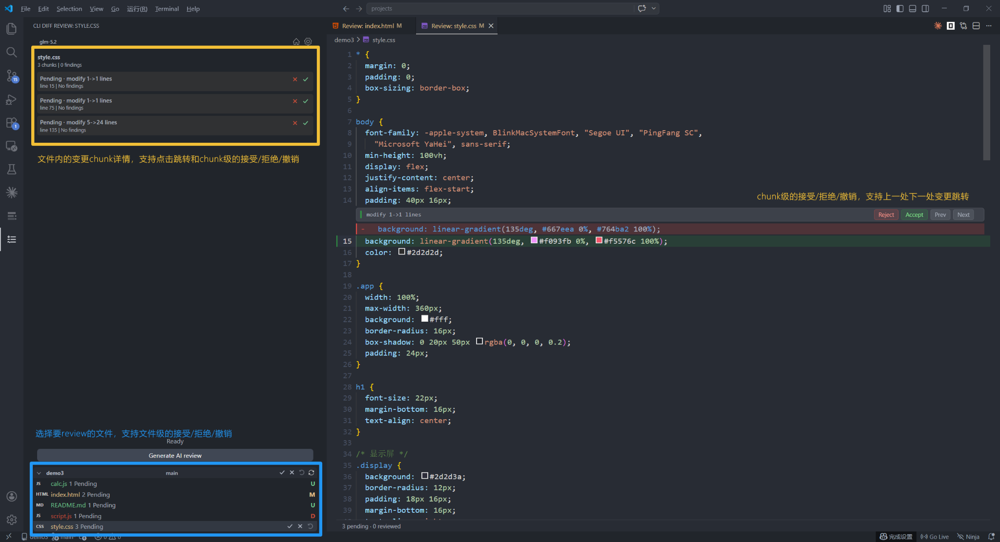
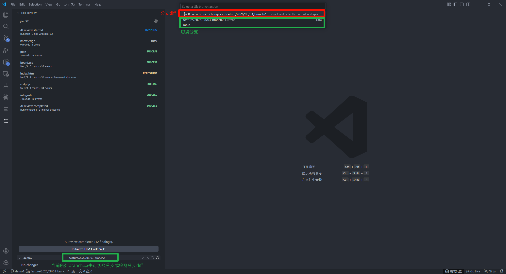
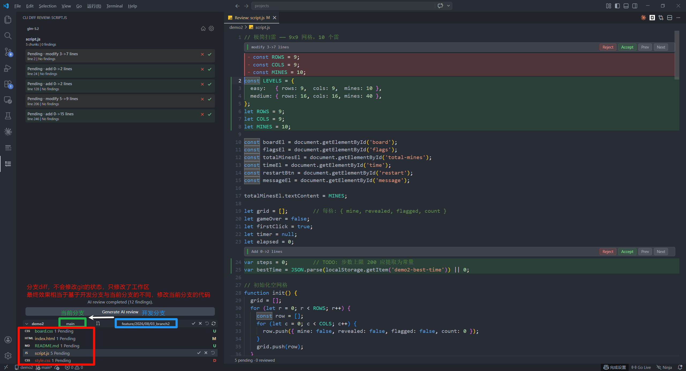
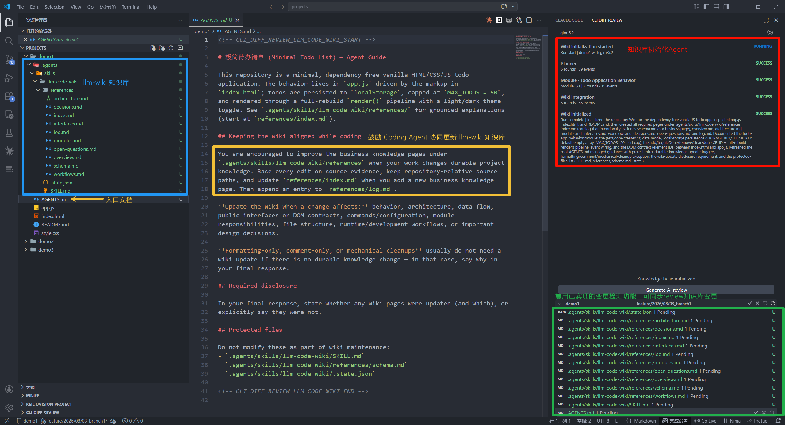
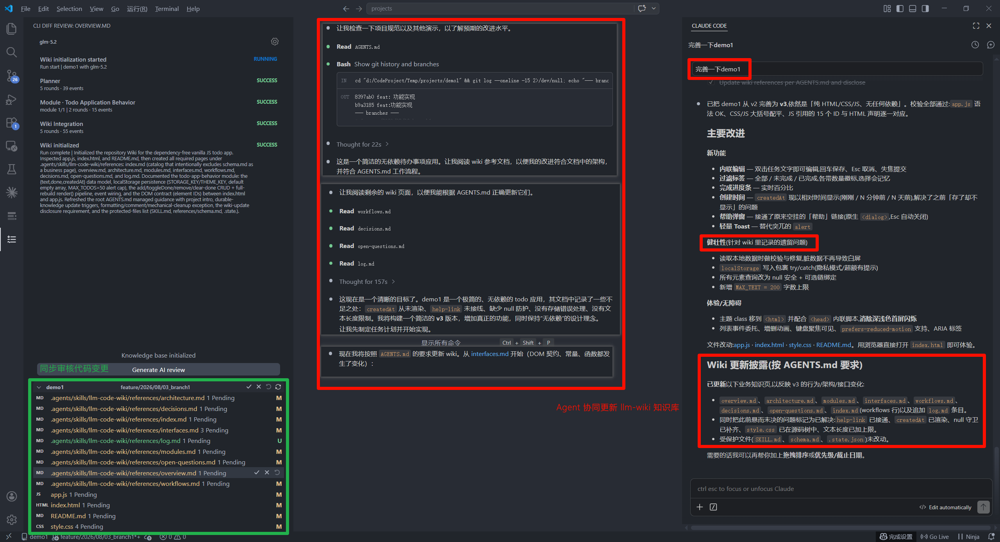
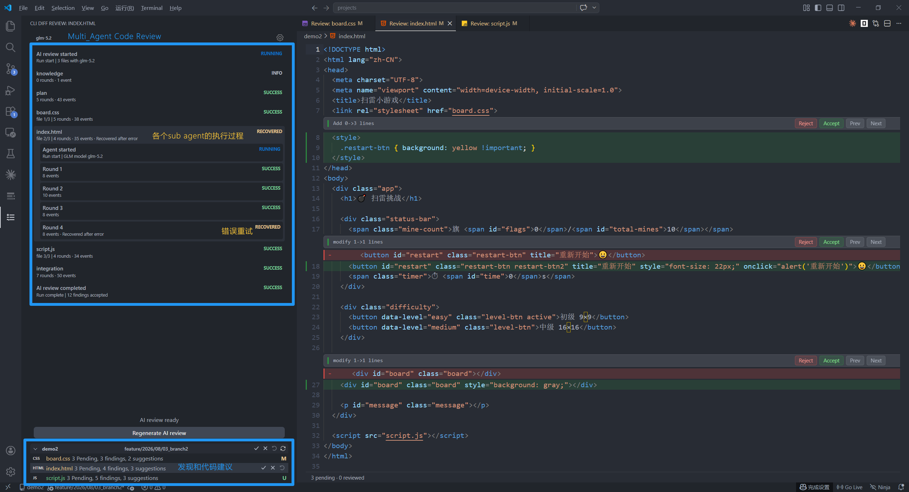
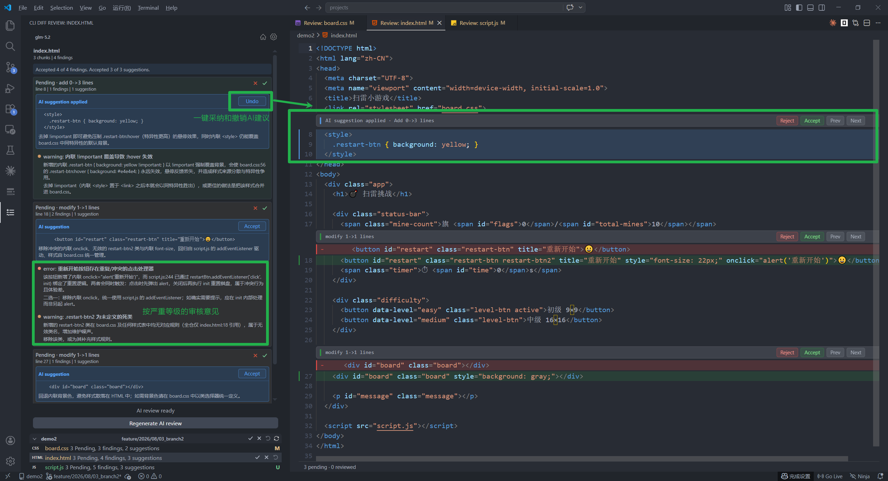

# Cli Diff Review

Cli Diff Review 是一个面向 CLI Coding Agent 的 VS Code 扩展。

它自动识别 Git 工作区中的代码变更，并提供类似 Cursor、GitHub Copilot 的逐块审阅体验。无论代码由 Codex、Claude Code、Gemini CLI 或其他工具生成，都可以在同一个界面中查看、接受、拒绝和撤销变更。

同时，插件参考 [llm-wiki](https://gist.github.com/karpathy/442a6bf555914893e9891c11519de94f) 理念为项目建立可持续更新的本地知识库，使项目知识能够被 Coding Agent 和 Review Agent 感知，并结合工作区或分支差异提供 Multi Agent AI Review。

> 🎬 项目介绍视频：[点击观看](VIDEO_URL)

## 核心原理

插件通过 Git 检测代码变化，以暂存区内容作为基线，将工作区中的未暂存修改转换为可审阅的 Diff Chunk，并在 VS Code 中高亮呈现。

许多 CLI Coding Agent 更关注任务执行，代码变更会直接写入工作区；部分交互流程还需要先接受当前变更，才能继续处理下一处修改。这使用户很难等 Agent 完成全部工作后，再对所有变更进行一次统一审阅。

终端中的 Diff 通常也只展示变更内容及其上下文，缺少完整的代码浏览能力，难以直接进行定义和引用跳转。

Cli Diff Review 将代码生成与代码审阅分离，通过 Git 汇总 Agent 产生的工作区变更，并在 VS Code 中提供统一的后置审阅体验。

你可以：

- 在 Agent 完成修改后统一审阅全部变更、按代码块或文件接受、拒绝和撤销变更
- 浏览完整文件，并从变更位置跳转到定义或引用
- 在修改之间快速跳转

这种方式不要求 Coding Agent 主动接入插件。只要 Agent 修改了 Git 工作区，Cli Diff Review 就能补充类似 Cursor 和 GitHub Copilot 的后置 Review 体验。

**交互说明**


**支持多项目变更检测**



**支持代码段/文件级/项目级review操作(接受/拒绝/撤销)**



### 在本地审阅 Pull Request

远程代码仓库提供的 Pull Request Review 通常围绕局部 Diff 展开。面对复杂变更时，很难浏览完整文件、跳转代码定义和引用，AI 生成的修改建议也难以直接应用到本地代码。

Cli Diff Review 可以将分支之间的代码差异提取到当前工作区，复用已有的代码变更检测和审阅能力，无需切换或合并待审分支。

这使 Pull Request 的代码审校可以在完整的本地开发环境中进行，不再受远程代码仓库局部 Diff 交互的限制。





## LLM Code Wiki

本项目的 LLM Code Wiki 基于 Karpathy 的 [llm-wiki](https://gist.github.com/karpathy/442a6bf555914893e9891c11519de94f) 思路改造。

它用于在 Vibe Coding 过程中为项目建立一个持续更新的本地知识库。知识库可以随代码仓库共享，被插件内置的 AI Review、其他 Coding Agent，以及远程代码仓库中的 Review Agent 感知和使用。

知识库以项目 Skill 的形式存在。初始化后的完整基础结构如下：

```text
AGENTS.md                                  ───── 向 Coding Agent 提供 Wiki 入口与协作规则

.agents/skills/llm-code-wiki/
├── SKILL.md                               ───── Coding Agent 使用知识库的入口
├── .state.json                            ───── 插件维护的运行状态与源码指纹
└── references/
    ├── schema.md                          ───── 知识库结构、维护规则与写入约束
    ├── index.md                           ───── 所有知识页面的导航索引
    ├── overview.md                        ───── 项目目标、用户与主要能力
    ├── architecture.md                    ───── 系统边界、组件关系与数据流
    ├── modules.md                         ───── 模块职责及对应源码位置
    ├── interfaces.md                      ───── 公共 API、命令、协议与数据结构
    ├── workflows.md                       ───── 运行流程与开发工作流
    ├── decisions.md                       ───── 重要设计决策与技术取舍
    ├── open-questions.md                  ───── 尚未确认的问题与不完整结论
    ├── log.md                             ───── 初始化和更新的追加式记录
    └── <其他主题>.md                      ───── 根据项目需要扩展的知识页面
```

插件内置 Agent 负责初始化知识库骨架；在后续开发中，Coding Agent 能够感知并读取该 Skill，与插件更新 Agent 共同维护项目知识。

源码始终是事实来源。知识库使用 Markdown 提炼项目架构、模块职责、开发流程、开发约定和重要设计信息，使项目知识能够随代码持续演进。

### 初始化与更新 Agent

知识库初始化和更新采用相同的多 Agent 流程。初始化会搭建完整知识库，后续更新则根据源码变化维护受影响的内容。

```text
┌──────────────────────────────┐
│ Wiki Planning Agent          │───── 分析项目结构或源码变化，规划需要处理的模块
└──────────────────────────────┘
               │
               ▼
┌──────────────────────────────┐
│ Module Analysis Agents       │───── 并行阅读相关源码和现有 Wiki，输出基于代码事实的模块分析
└──────────────────────────────┘
               │
               ▼
┌──────────────────────────────┐
│ Wiki Integration Agent       │───── 汇总模块分析，创建或更新 Wiki 页面、索引和项目 Agent 指引
└──────────────────────────────┘
```

### 与 RAG 的取舍

LLM Code Wiki 并不是为了替代 RAG。RAG 更适合从大量资料中检索相关内容，而 LLM Code Wiki 更关注如何让 Coding Agent 持续理解并维护当前项目。

| LLM Code Wiki                          | RAG                                  |
| -------------------------------------- | ------------------------------------ |
| 将项目知识整理为结构化 Markdown        | 将文档切分、索引后按问题检索         |
| 内容可读、可编辑，可通过 Git 管理      | 更擅长从大量资料中进行语义召回       |
| Coding Agent 可以直接读取项目 Skill    | Agent 需要接入检索服务               |
| 架构简单，不需要向量数据库和 Embedding | 通常需要额外的索引和存储基础设施     |
| 适合维护架构、模块职责和开发约定       | 适合处理大规模、分散且频繁查询的资料 |
| 依赖 Agent 持续维护内容                | 依赖文档分块、Embedding 和召回质量   |

LLM Code Wiki 的优势是轻量、透明和可版本管理，适合保存 Coding Agent 需要反复参考的项目知识。面对超大型项目或大量非结构化资料时，它的语义检索和信息召回能力通常不如完整的 RAG 系统。

两者关注的问题不同，也可以在更复杂的场景中配合使用。






## AI Review

Cli Diff Review 可以基于当前工作区变更或分支差异运行 AI Code Review。

AI Review 支持：

- 分析代码变更中的潜在问题
- 结合当前源码和 LLM Code Wiki 理解项目上下文
- 检查跨文件调用、配置和集成问题
- 将问题和修改建议关联到具体代码块
- 直接应用或撤销 AI 修改建议

### 多 Agent 审阅架构

完整的代码审阅由多个 Agent 协作完成：

```text
┌──────────────────────────────┐
│ Knowledge Retrieval Agent    │───── 从 LLM Code Wiki 提取相关知识，并使用当前源码验证关键结论
└──────────────────────────────┘
               │
               ▼
┌──────────────────────────────┐
│ Review Planning Agent        │───── 分析整个变更集，规划需要重点检查的文件和风险
└──────────────────────────────┘
               │
               ▼
┌──────────────────────────────┐
│ File Review Agents           │───── 并行审阅各个文件，将问题和修改建议关联到具体 Diff Chunk
└──────────────────────────────┘
               │
               ▼
┌──────────────────────────────┐
│ Integration Review Agent     │───── 综合文件审阅结果，检查跨文件调用、配置和整体集成问题
└──────────────────────────────┘
```

支持 OpenAI、Anthropic，并针对 DeepSeek 和 GLM 模型服务进行了专门适配。




